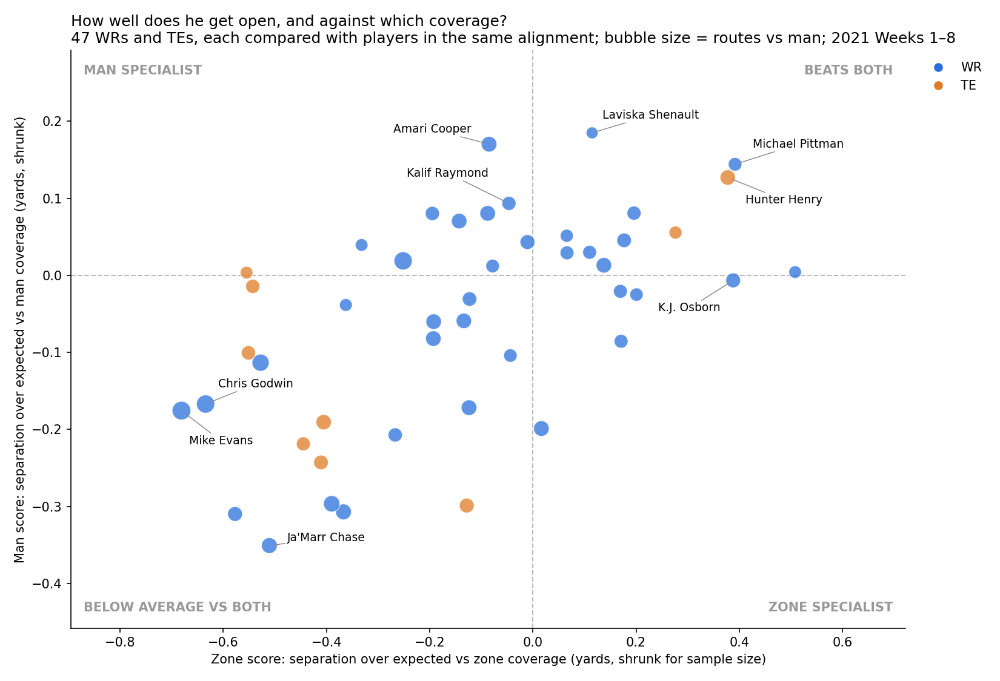
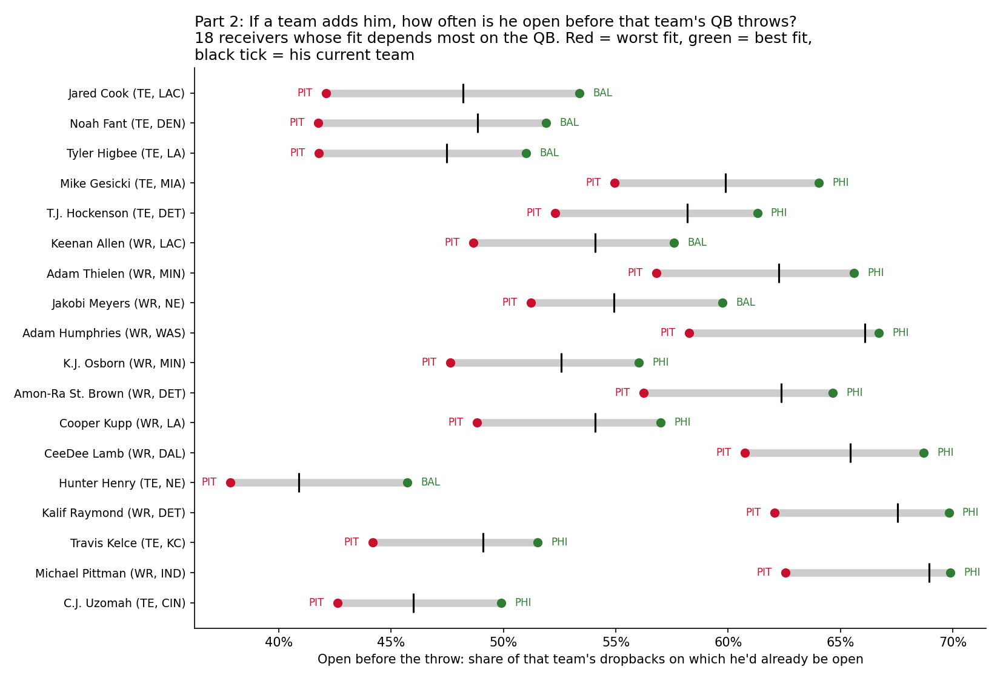
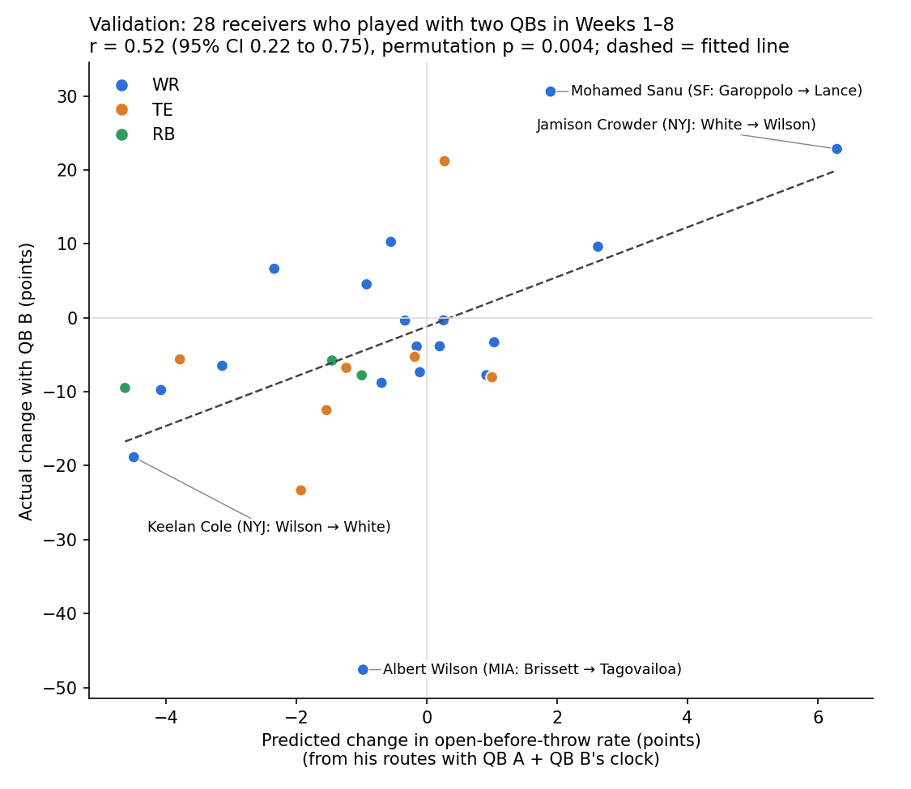

# Pocket_Myth: methods and full results

*Short version: see [README.md](README.md).*

We answer one question for WRs and TEs, using 2021 NFL tracking data (Weeks 1–8): is this receiver good at getting open, and would he fit a given team's quarterback? **Part 1** scores how much separation each receiver creates against man and against zone coverage, compared with players in the same alignment, sorting 47 regular receivers into types such as *beats both* (Michael Pittman, Hunter Henry), *man specialist* (Amari Cooper, Kalif Raymond) and *zone specialist* (K.J. Osborn). **Part 2** combines each receiver's open-time curve with every team's dropback clock to estimate how often he'd be open before that team's QB throws: Pittsburgh's quick release is the worst fit for everyone, Philadelphia and Baltimore the best, and tight ends are most sensitive to the QB. We validated Part 2 on the seven teams that changed quarterbacks in Weeks 1–8: for 28 receivers, the predicted change in being open before the throw matched the actual change (r = 0.52, permutation p = 0.004; r = 0.93 for players with 50+ routes under both QBs), while a weak offensive line, by contrast, showed no measurable effect. Limitations: the model gets the direction of a QB change right but underestimates its size, it doesn't yet predict target share, and 8 weeks of data leaves wide intervals on individual scores.

---

## Part 1: Is he good at getting open, and against which coverage?

**Why getting open matters:** completion rises with separation even among throws of the same depth. Short passes go from 23% under 1 yard to 84% at 6+ yards, deep passes from 23% to 69%.

**Man score / Zone score:** average separation from the nearest defender at the moment of the throw, minus what a typical player **in the same alignment** (outside WR, slot, inline TE, backfield) gets in that coverage with the same time to throw. Each score is shrunk toward zero according to how noisy the player's sample is (empirical Bayes), so a lucky small sample can't top the list.



| Type | Players |
|---|---|
| **Beats both** (11) | Laviska Shenault, Michael Pittman, Hunter Henry, Cooper Kupp, Noah Fant |
| **Man specialist** (10) | Amari Cooper, Kalif Raymond, Robby Anderson, Cole Beasley, Keenan Allen |
| **Zone specialist** (5) | K.J. Osborn, Demarcus Robinson, Robert Woods, Tim Patrick |
| **Below average vs both** (21) | Mike Williams, Ja'Marr Chase, Mike Evans, Chris Godwin (players who win through contested catches, not separation) |

Man and zone scores are related (r = 0.59): good separators tend to be good against both, but the specialists show where a coordinator should use a player. Full table: [`player_profiles.csv`](output/player_profiles.csv). Man-coverage scores: [`man_scores.csv`](output/man_scores.csv).

## Part 2: If a team adds him, would he fit that team's quarterback?

**QB fit** = the share of a team's dropbacks on which the receiver would already be open when the dropback ended. It combines:
- **his open-time curve:** when he gets open, at least 0.5 s after the snap, 3+ yards past the line and 3+ yards from every coverage defender. It's a Kaplan-Meier curve in which routes cut short by his own QB's throw count as *unknown after this point*, so his current team doesn't leak into his profile.
- **the team's dropback clock:** every dropback, not just the average.



- **Pittsburgh is the worst fit for all 47 receivers.** It has the quickest release in the league (median 2.4 s), so routes have the least time to develop. **Philadelphia (40 players) and Baltimore (7) are the best fits.**
- **Tight ends depend most on the QB:** about 9 points between their best and worst fit, vs about 7 for WRs. Late-developing TEs like Jared Cook, Noah Fant and Tyler Higbee would be open on about 42% of Pittsburgh dropbacks but about 52% of Baltimore's.
- **Example:** Hunter Henry *beats both* coverages (Part 1) but develops late. He's open before the throw on 41% of New England dropbacks, which would rise to 46% with Baltimore's QB and fall to 38% with Pittsburgh's.
- Full 47 × 32 table: [`qb_fit_matrix.csv`](output/qb_fit_matrix.csv).

### Validation: does Part 2 predict what happens when the QB changes?

Seven teams changed quarterbacks in Weeks 1–8 (CHI, DAL, HOU, MIA, NYJ, SEA, SF). That gives a natural test: same receivers, different QB clock. For each of 28 receivers, we learned his open-time curve **only from his routes with QB A**, predicted his open-before-throw rate with QB B **from QB B's dropback times alone**, and compared the predicted change with the actual change.



- **The predictions track reality:** r = 0.52 (95% CI 0.22 to 0.75), rank correlation 0.59, permutation p = 0.004, and the same direction in 71% of cases.
- **Larger samples give tighter agreement:** r = **0.93** for the 11 receivers with 50+ routes under both QBs.
- **Examples:**
  - Jets: Jamison Crowder went from Mike White (2.6 s) to Zach Wilson (3.0 s). Predicted up, actual **+23 points**.
  - Jets: Keelan Cole went the other way. Predicted down, actual **−19 points**.
  - 49ers: Mohamed Sanu went from Jimmy Garoppolo to Trey Lance (3.25 s). Predicted up, actual **+31 points**.
- **What it gets wrong:** actual changes are about 3× larger than predicted (a new QB changes more than timing), and the change in **target rate** is not yet predicted (r = 0.14, CI includes zero). Treat the fit as "will he be open in time with this QB", not "how many targets will he get". Data: [`qb_change_validation.csv`](output/qb_change_validation.csv).

### Why the quarterback, not the offensive line?

We first tested the common assumption that late-opening receivers are wasted behind a weak line. A timing model predicts it, but on actual plays late openers on weak-line teams got open, got targeted and caught the ball no worse, relative to early openers, than on strong-line teams. That holds with both a tracking-based line measure and PFF's pressure rate, and across five distance thresholds ([`fit_sensitivity.csv`](output/fit_sensitivity.csv)). The tracking pocket measure mostly reflects how fast the QB throws (rank correlation 0.41), which is why Part 2 is built on the QB's clock.


## Who uses it

- **GMs and scouts:** Part 1 shows whether a receiver gets open and against what. Part 2 shows whether he'd be open in time with *your* quarterback.
- **Offensive coordinators:** call routes that beat man coverage for man specialists. With a quick-release QB, favor receivers who get open early.

## Limitations

- **Small sample:** 8 weeks, about 40–70 man routes per player, so individual intervals are wide. Tracking ends about 0.5 s after the throw.
- **Part 2 understates the size** of a QB change, and doesn't predict target share. It was validated on 7 teams and 28 receivers.
- **"Open" uses distance thresholds**, and open time also reflects route design.
- **Targeted receiver:** taken from `playDescription`. 98.6% of throws that name a receiver were matched, and throwaways are excluded.

## Data checks we ran first

[`src/explore.py`](src/explore.py) and [`src/traps.py`](src/traps.py) check the following:
- **Join keys:** unique, so joins don't duplicate rows.
- **Duplicate events:** each play has both manual and automatic snap and throw events, so we use the manual ones.
- **Tracking extent:** it stops about 0.5 s after the throw.
- **Missing target column:** there's no "targeted receiver" field, so we parse it from the play description.
- **Play direction:** some plays go left, so coordinates are flipped so every play goes the same way.

## Reproduce (about 2 minutes)

```bash
git clone --depth 1 https://github.com/ThompsonJamesBliss/nfl-big-data-bowl-regional-event-data.git data-src
pip install -r requirements.txt
python src/build_features.py    # per-route separation at the throw, alignment, depth, target
python src/man_score.py         # Part 1: man-coverage scores, separation payoff numbers
python src/fit_score.py         # open-time and pocket curves for every player and team
python src/profile_fit.py       # Part 1 profile, Part 2 QB fit, QB-change validation
python src/fit_deep.py          # why the QB, not the line: model vs real plays (printed)
python src/fit_sensitivity.py   # robustness of the line result across distance thresholds
python src/qb_clock.py          # extra: each receiver's open time vs his own QB's clock
```
