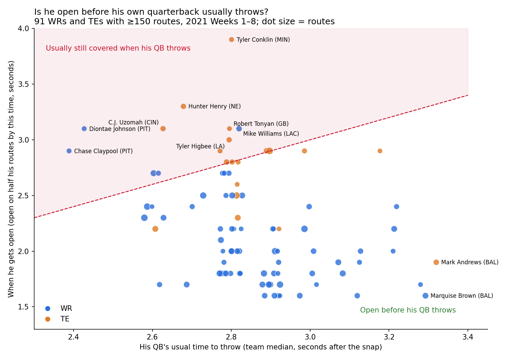

# Does a late-opening receiver need a strong offensive line?

We asked whether a WR or TE who gets open late in a play needs a strong offensive line to be useful. Using 2021 NFL tracking data (Weeks 1–8), we timed when each team's pocket collapses and when each receiver gets open on every dropback. A timing model built from those measurements predicts that late openers (mostly tight ends) are hurt most by a weak line, but on actual plays they got open, got targeted and caught the ball no worse, relative to early openers, behind weak lines than behind strong ones. The mismatch that does show up is with a receiver's **own** quarterback: 18 of 91 WRs and TEs (13 of them TEs, plus Pittsburgh's Diontae Johnson and Chase Claypool facing a league-fastest 2.4-second release) are usually still covered when their QB throws. Takeaway for coaches and GMs: don't discount a late-opening TE because of a weak line, but check that his timing fits the quarterback's. Limitations: 8 weeks of data, distance-threshold definitions of "open" and "pocket collapse", and team comparisons that also differ in QB and scheme.

---

## The question

Some receivers get open early (quick routes), others late (deeper or slower-developing routes). Some offensive lines hold up long, others collapse fast. The common assumption: **a late opener behind a fast-collapsing line is wasted**, because the QB has to throw before he's open. We tested whether that's true.

## How we measured it (tracking data, frame by frame)

| What | Definition |
|---|---|
| **Pocket collapse** | First frame after the snap when any pass rusher is within 2 yards of the QB. Per team: a Kaplan-Meier curve of "pocket still intact at time *t*". A play that ends in a throw before any collapse counts as *intact up to then*. |
| **Receiver open** | First frame ≥0.5 s after the snap when he is ≥3 yards past the line and ≥3 yards from every coverage defender. Per player: a Kaplan-Meier curve of "open by time *t*". Routes cut short by his QB's throw count as *unknown after this point*, so his own team's line doesn't leak into his profile. |
| **Fit Score** | Chance he gets open while a given team's pocket is still intact. Computed for 99 players × 32 teams: [`fit_scores.csv`](output/fit_scores.csv), with best and worst team fits per player in [`fit_best_teams.csv`](output/fit_best_teams.csv). |
| **QB clock** | His own team's median time from snap to the end of the dropback (2.4 s for PIT up to 3.3 s for BAL). |

## Finding 1: the model says late openers need a strong line, but real plays say they don't


- **Model (left).** Moving a receiver from the 5 best pocket-keeping teams to the 5 worst costs early openers (~1.5 s) about **5 points** of "open while the pocket holds", and late openers (~1.9 s) about **8 points**. Open time and loss correlate at r = 0.86 (r = 0.74 among WRs only). The most exposed are TEs: Tyler Conklin, Jared Cook, Noah Fant, Darren Waller.
- **Reality (right).** On each team's actual plays, we compared late vs early openers on weak-line vs strong-line teams (a difference-in-differences with game-bootstrap 95% CIs). Late openers suffered **no extra penalty** in getting open before the throw (+0.2 points, CI −4.2 to +5.1), in being targeted, or in catching the ball. This holds whether "weak line" means our tracking pocket measure or **PFF's charted pressure rate**.
- **Why the model fails:** our tracking pocket measure mostly reflects how fast the QB throws (rank correlation 0.41), not PFF's pressure charting (0.05). QBs and play-callers adapt, for example with quicker reads behind a weak line, so the "wasted" late opener doesn't show up in practice.
- **Robustness:** [`fit_sensitivity.csv`](output/fit_sensitivity.csv) reruns everything with open distances of 2.5, 3 and 3.5 yd and collapse distances of 1.5, 2 and 2.5 yd. The model's direction holds every time (r = 0.83–0.89), and the real-play gap includes zero every time. The model's *size* swings with the collapse distance, so we quote only its direction.

## Finding 2: the timing that matters is his own QB's clock



- 73 of 91 WRs and TEs are open on half their routes **before** their QB usually throws. On average a receiver is already open on 61% of his routes at his QB's usual throw time (range 42–81%).
- **18 are out of sync:** they're open on half their routes only at or after the QB's usual throw time, or not at all by 4 s. **13 are tight ends** (Tyler Conklin, Hunter Henry, C.J. Uzomah, Robert Tonyan, Tyler Higbee, among others). The WRs include Pittsburgh's **Diontae Johnson** and **Chase Claypool**, whose QB throws fastest in the league (2.4 s).
- The best-synced are Baltimore's receivers (Marquise Brown, Devin Duvernay, Mark Andrews): their QB holds the ball longest (3.3 s), and they're open well before.
- **Caution:** being open by the QB's clock barely predicts a player's target rate (r = 0.09), so treat this as a **timing flag** for coaches (routes vs QB tempo), not a performance score. Full table: [`open_vs_qb_clock.csv`](output/open_vs_qb_clock.csv).

## Who uses it

- **GMs and coaches** evaluating a receiver: don't downgrade a late-opening TE because of your line. Check his timing against your QB's tempo instead.
- **Offensive coaches:** spot receivers whose routes develop after the QB's usual release, and adjust route depth or the QB's progression.

## Limitations

- **Small sample:** 8 weeks of data, and tracking ends about 0.5 s after the throw.
- **"Open" and "pocket collapse"** are distance thresholds, not tactical judgments. Open time also reflects route design, not just player skill.
- **The real-play check compares teams**, which also differ in QB, scheme and play-calling.
- **Targeted receiver:** taken from `playDescription`. Throwaways have no intended receiver and are excluded. 98.6% of throws that name a receiver were matched.

## Data checks we ran first

[`src/explore.py`](src/explore.py) and [`src/traps.py`](src/traps.py) check the following:
- **Join keys:** unique, so joins don't duplicate rows.
- **Duplicate events:** each play has both manual and automatic snap and throw events, so we use the manual ones.
- **Tracking extent:** it stops about 0.5 s after the throw.
- **Missing target column:** there's no "targeted receiver" field, so we parse it from the play description.
- **Play direction:** some plays go left, so coordinates are flipped so every play goes the same way.

## Reproduce (about 2 minutes)

```bash
git clone --depth 1 https://github.com/ThompsonJamesBliss/nfl-big-data-bowl-regional-event-data.git data-src
pip install -r requirements.txt
python src/build_features.py    # per-route data at the throw (targets, time to throw)
python src/fit_score.py         # pocket-collapse and open-time curves, Fit Scores
python src/fit_deep.py          # Finding 1: model vs real plays chart, best-fit teams
python src/fit_sensitivity.py   # Finding 1: robustness across distance thresholds
python src/qb_clock.py          # Finding 2: open time vs own QB's clock
```
