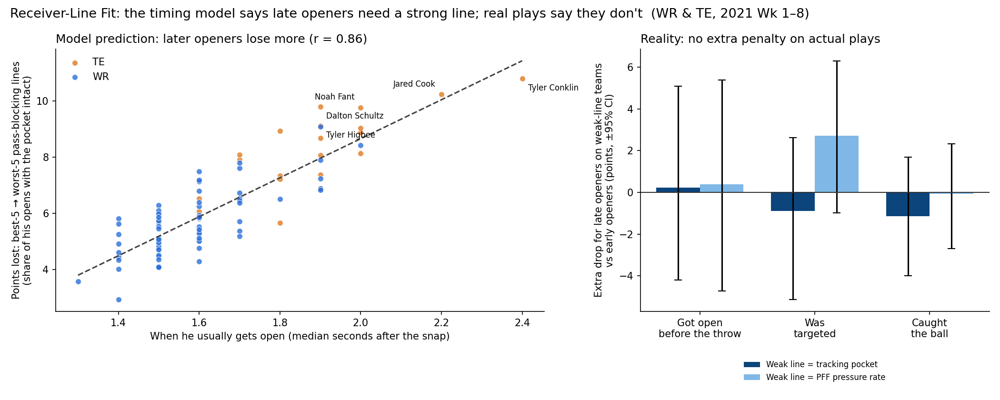

# Who gets open against man coverage, and does a late-opening receiver need a strong line?

We used 2021 NFL tracking data (Weeks 1–8) to answer two questions about WRs, TEs and RBs: who creates separation against man coverage, and does a receiver who gets open late need a strong offensive line? Separation pays off even among throws of the same depth: completion on short passes rises from 23% under 1 yard of separation to 84% at 6+ yards. Our **Man-Beater Score** ranks Laviska Shenault, Amari Cooper, Michael Pittman and Hunter Henry highest, and shows QBs under-target some open receivers (Kalif Raymond, Cole Beasley). A timing model predicts that late openers (mostly tight ends) are wasted behind weak lines, but on actual plays they were not hurt more than early openers, so a GM shouldn't discount a late-opening TE because of a weak line. Limitations: 8 weeks is a small sample (every player's interval crosses zero), tracking stops 0.5 s after the throw, and "open" and "pocket collapse" rely on distance thresholds, though the conclusions hold across five settings.

---

## Q1. Does getting open matter?

For each route we measured the distance to the nearest coverage defender at the moment of the throw.


- Open WRs and TEs are targeted more often, especially against man coverage.
- Completion rises with separation **within the same throw depth**, so this isn't just "short passes are easier". Short throws go from 23% to 84%, deep throws from 23% to 69%.

## Q2. Who gets open against man coverage? (Man-Beater Score)

**Man-Beater Score** = a player's average separation against man coverage, minus what a typical player **in the same alignment** (outside WR, slot, inline TE or backfield) gets with the same time to throw. It is then shrunk toward zero according to how noisy each player's sample is (empirical Bayes), so a player with a lucky small sample can't top the list.


- **Top:** Laviska Shenault (+0.18 yd), Amari Cooper, Michael Pittman, Hunter Henry, Kalif Raymond.
- **Bottom:** Dan Arnold, Ja'Marr Chase, Quez Watkins, Mike Williams, Tyler Boyd.
- **Use it as a scouting flag, not a verdict.** 78 players have at least 40 man routes, the split-half reliability is r = 0.34, and every 95% interval crosses zero.

## Q3. Do QBs throw to the players who beat man coverage?


Both axes compare a player with others in the **same alignment**, so TEs and RBs aren't penalized for naturally getting fewer targets.

- **Open but Ignored:** Kalif Raymond, Cole Beasley and Laviska Shenault get open but are targeted less than expected. A coach could call more plays for them against man.
- **Covered but Fed:** Travis Kelce, T.J. Hockenson, Tee Higgins and Kyle Pitts are targeted more than expected despite tight coverage. QBs trust them in tight windows.
- Overall, the link between getting open against man and being targeted is weak (r = 0.11).

## Q4–Q5. Does a late-opening receiver need a line that holds? (Receiver-Line Fit)

**Idea.** Some receivers get open early, some late. Some lines hold up and some collapse fast. A late opener behind a fast-collapsing line should be wasted.

**What we measured (tracking data):**
- **Pocket collapse:** the first frame a pass rusher is within 2 yards of the QB. Per team, we built a Kaplan-Meier curve of "pocket still intact at time t". A play that ends in a throw before any collapse counts as *still intact up to then*.
- **Receiver open time:** the first frame at least 0.5 s after the snap where he is 3+ yards past the line and 3+ yards from every coverage defender. Per player, we built a Kaplan-Meier curve in which routes cut short by his own QB's throw count as *unknown after this point*, so his own team's line doesn't leak into his profile.
- **Fit Score** = the chance he gets open while a given team's pocket is still intact. It's computed for 99 players × 32 teams in [`output/fit_scores.csv`](output/fit_scores.csv), with each receiver's 3 best and worst team fits in [`output/fit_best_teams.csv`](output/fit_best_teams.csv).



**Findings:**
- **The model predicts the effect** (left panel). Moving a receiver from the 5 best pocket-keeping teams to the 5 worst costs early openers (~1.5 s) about 5.0 points and late openers (~1.9 s) about 7.9 points. Open time and loss correlate at r = 0.86 (r = 0.74 among WRs only). The most exposed players are TEs: Tyler Conklin, Jared Cook, Noah Fant and Darren Waller.
- **Real plays don't show it** (right panel). On each team's actual plays, late openers on weak-line teams were not hurt more than early openers, whether we measured getting open before the throw (+0.2 points, 95% CI −4.2 to +5.1), being targeted, or catching the ball. This holds for both definitions of a weak line: our tracking pocket measure and PFF's charted pressure rate.
- **Why:** the tracking pocket measure mostly reflects how quickly a QB throws (rank correlation 0.41) rather than PFF's pressure charting (0.05). QBs and play-callers adapt, for example with quicker reads behind a weak line, so the "wasted" late opener doesn't show up in practice.
- **Takeaway for a GM:** judge a receiver on his own ability to get open, and don't discount a late-opening TE just because your line is weak.
- **Robustness:** [`output/fit_sensitivity.csv`](output/fit_sensitivity.csv) reruns everything with open distances of 2.5, 3 and 3.5 yd and collapse distances of 1.5, 2 and 2.5 yd. The model's direction holds in every case (r = 0.83–0.89), and the real-play gap includes zero in every case. The model's *size* depends strongly on the collapse distance, so we quote only its direction.

## Limitations

- **Small sample:** 8 weeks, about 40–70 man routes per player.
- **Tracking ends** about 0.5 s after the throw, so separation at the catch isn't measured.
- **Targeted receiver:** taken from `playDescription`. Throwaways have no intended receiver and are excluded. 98.6% of throws that name a receiver were matched.
- **"Open" and "pocket collapse"** are distance thresholds, not tactical judgments.
- **Open time** also reflects route design, not just player skill.
- **The real-play check** compares teams, which also differ in QB, scheme and play-calling.

## Reproduce (about 2 minutes)

```bash
git clone --depth 1 https://github.com/ThompsonJamesBliss/nfl-big-data-bowl-regional-event-data.git data-src
pip install -r requirements.txt
python src/build_features.py    # per-route separation at the throw, alignment, depth
python src/man_beater.py        # Q1-Q3: Man-Beater scores + 3 charts
python src/fit_score.py         # Q4-Q5: pocket and open-time curves, Fit Scores
python src/fit_deep.py          # Q4-Q5: model vs real plays chart, best-fit teams
python src/fit_sensitivity.py   # Q4-Q5: robustness across distance thresholds
```

`src/explore.py` and `src/traps.py` are the data checks we ran first: join keys, coverage labels, duplicate snap and throw events, where tracking ends, and target parsing.
