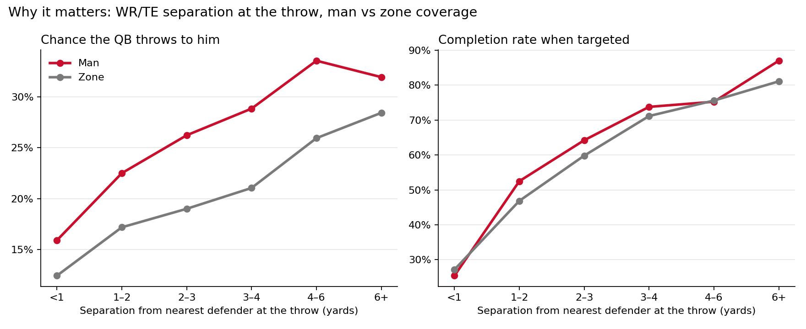
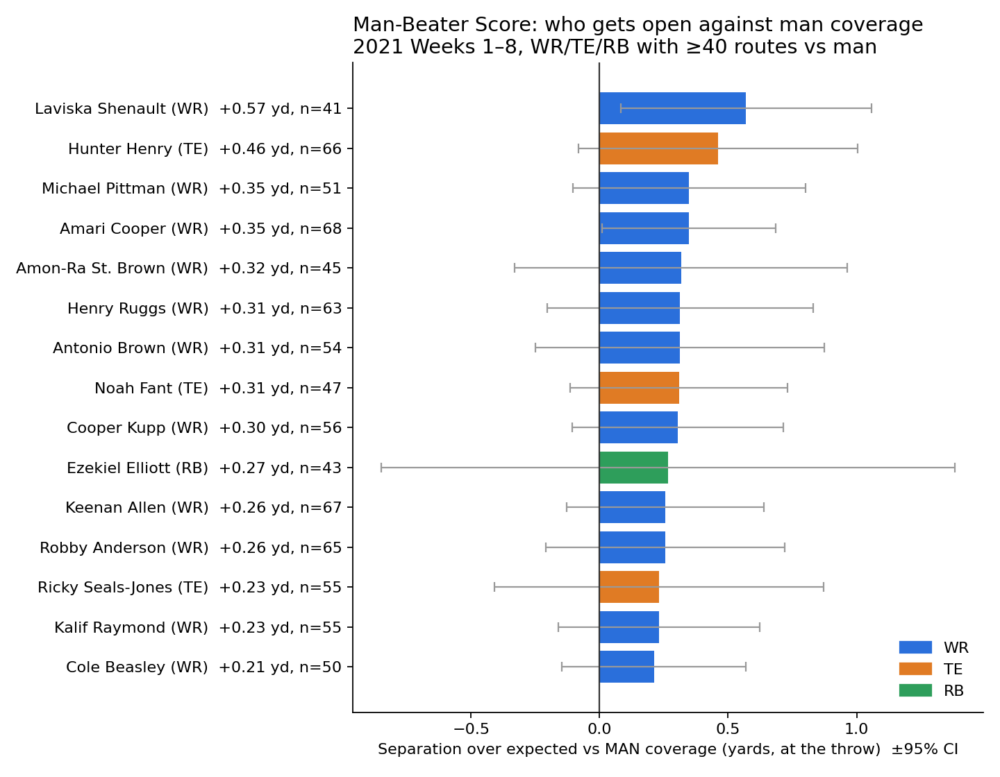
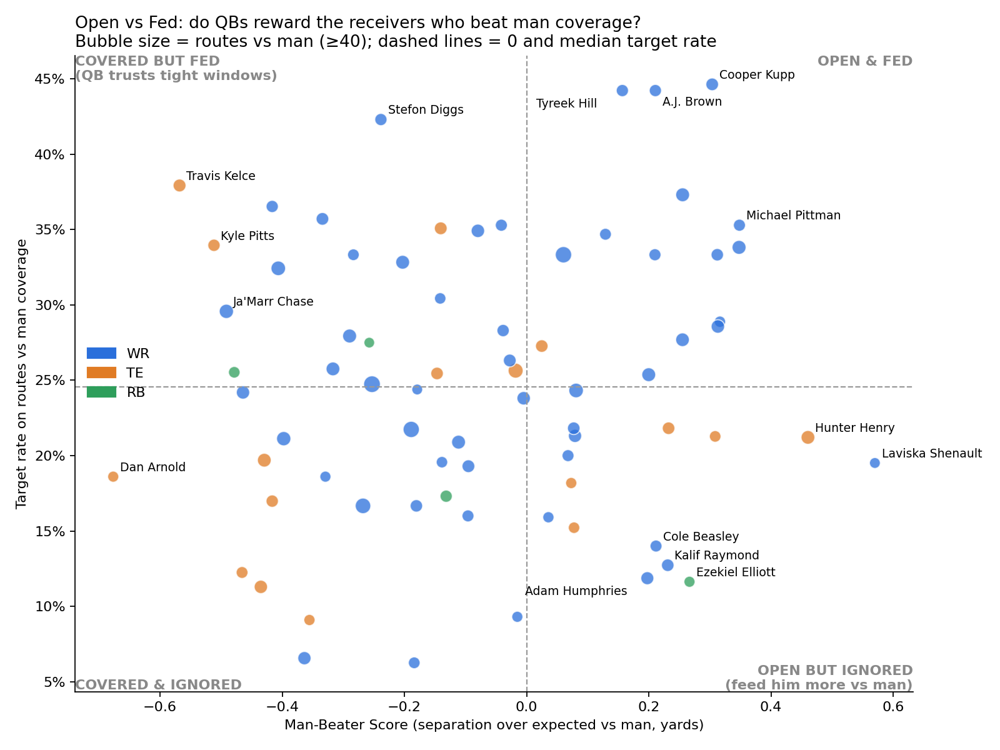
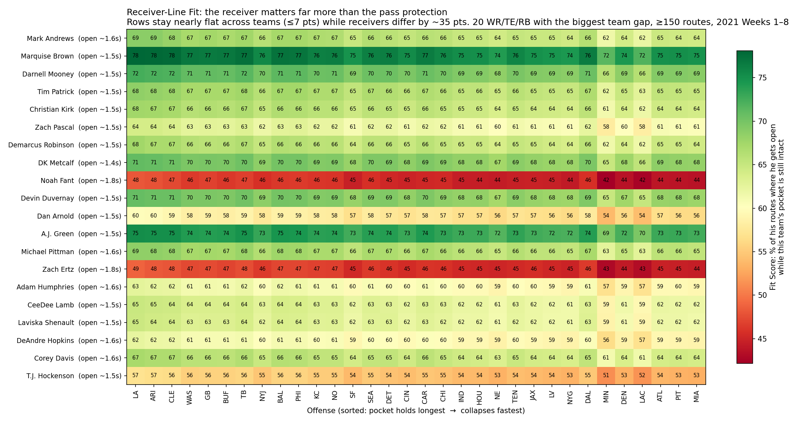

# Man-Beater Score: who gets open against man coverage, and do QBs notice?

We built the **Man-Beater Score**, a new metric for WRs, TEs and RBs: a player's separation from the nearest defender at the moment of the throw, against man coverage, minus what a typical player at his position gets in that coverage with the same time to throw (2021 Weeks 1–8 tracking, 30,288 routes, 74 players with ≥40 routes vs man). Separation clearly pays off, since WR/TE completion rate climbs from 25% under 1 yard of separation to 74% at 3–4 yards, yet QBs don't consistently feed the players who create it: Kalif Raymond, Cole Beasley, Adam Humphries and Ezekiel Elliott beat man coverage but are targeted only 12–14% of the time, while Travis Kelce, Kyle Pitts and Ja'Marr Chase get the least separation and are still targeted 30–38% of the time. Coaches can use the "Open but Ignored" list to call plays against man, and scouts can use the score to find route runners whose production undersells them. Method: positions come from the tracking frame of the first `pass_forward` event, defenders are players with PFF role `Coverage`, the targeted receiver is parsed from `playDescription` (the 7% of throws we couldn't match were dropped), and expected separation is a linear fit on time-to-throw within each position × coverage group. Limitations: tracking ends ~0.5 s after the throw so we can't measure separation at the catch, samples are small (40–70 man routes per player, wide confidence intervals, split-half reliability r = 0.27) so treat the score as a scouting flag rather than a verdict, and target rate isn't adjusted for position or for the other options on the play.

## Results

**1. Separation pays off, especially against man**


**2. Man-Beater leaderboard (±95% CI)**


**3. Open vs Fed: who beats man coverage but doesn't get the ball**


All scores: [`output/man_beater_scores.csv`](output/man_beater_scores.csv) · per-route data: [`output/route_separation.csv`](output/route_separation.csv)

## Bonus: does a receiver need a good offensive line? (Receiver-Line Fit)

We also tested whether some receivers "fit" some offenses better: a receiver who gets open late should be wasted behind a line that collapses fast. For each team we measured **how long the pocket stays intact** (first frame a pass rusher gets within 2 yards of the QB, with a Kaplan-Meier curve so plays that end in a throw before any collapse still count), and for each receiver **when he first gets open** (≥3 yards from every coverage defender, ≥3 yards past the line, ≥0.5 s after the snap). The Fit Score is the share of his routes on which he gets open while that team's pocket would still be intact. **Finding: fit barely depends on the line.** Receivers get open early (median 1.6 s), before most pockets collapse, so a receiver's score moves only ~5–7 points between the best and worst pass-blocking teams. Team averages span just 49–54%, while receivers span 5–76%. For a coach deciding who to add, the receiver's own ability to get open matters far more than the line he would play behind. (Limitations: "open" uses fixed distance thresholds, open time also reflects route design, and a new team's QB and play-calling would change things.)



Fit scores for 99 players × 32 teams: [`output/fit_scores.csv`](output/fit_scores.csv)

## Reproduce (about 15 seconds)

```bash
git clone --depth 1 https://github.com/ThompsonJamesBliss/nfl-big-data-bowl-regional-event-data.git data-src
pip install -r requirements.txt
python src/build_features.py   # -> output/route_separation.csv
python src/man_beater.py       # -> scores CSV + 3 charts
python src/fit_score.py        # -> fit scores + heatmap (bonus)
```

`src/explore.py` and `src/traps.py` are the data checks we ran first: join keys, coverage labels, duplicate snap/throw events, where tracking ends, and target parsing.
